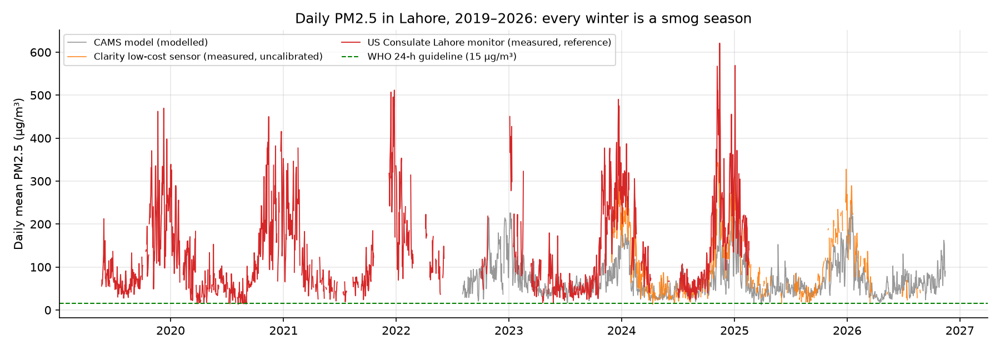
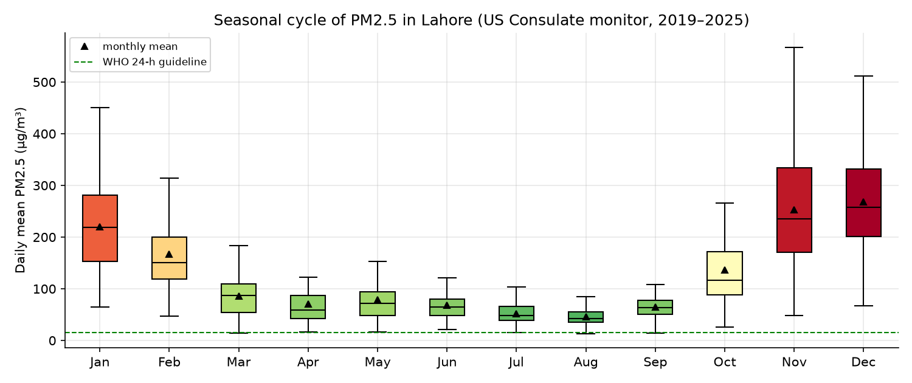
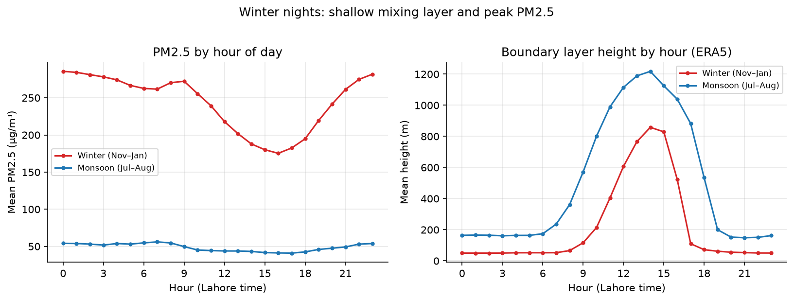
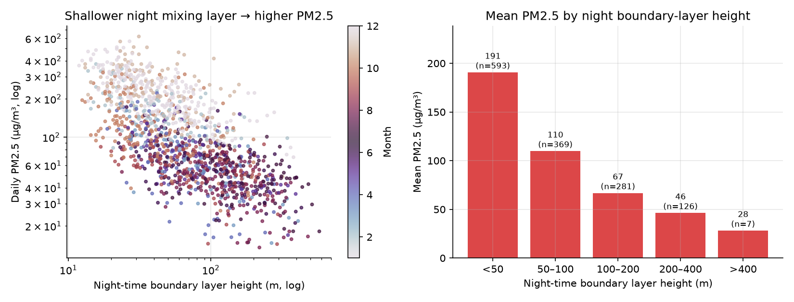
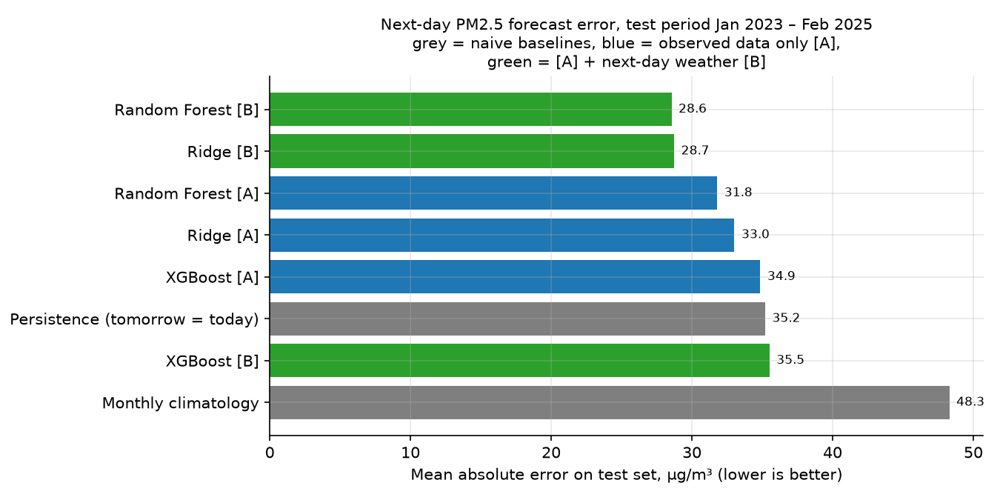

# Lahore Air Intelligence

**AI-Driven Analysis and Prediction of Air Pollution in Lahore, Pakistan**

*An independent research project by Syed Aown Raza Naqvi, Lahore, Pakistan. Started November 2026.*



## The problem

Lahore is regularly ranked among the most polluted cities on Earth. In 2024 its annual average PM2.5 was 102 µg/m³, about 20 times the WHO guideline ([IQAir](https://www.iqair.com/newsroom/5-most-polluted-major-cities-in-world-2024)), and the Air Quality Life Index estimates that clean air would add **5.8 years** to the life expectancy of people in Lahore ([AQLI](https://aqli.epic.uchicago.edu/files/Pakistan%20FactSheet_2025.pdf)). Every winter the city fills with smog that comes from many sources — vehicles, brick kilns and industry, crop-residue and waste burning, and pollution carried in from the wider region — and is trapped by cold, still air under a temperature inversion.

I live here. My long-term goal is to help Lahore **predict hazardous air before it happens** and give people and decision-makers better information to act on, using data science and machine learning.

## Research question

> How do seasonal and meteorological conditions influence PM2.5 concentrations in Lahore, and can machine learning predict short-term changes?

1. How have PM2.5 concentrations changed over recent years?
2. Which months and seasons are worst?
3. How is PM2.5 related to temperature, humidity, wind, rain and boundary-layer height?
4. Can ML models predict next-day PM2.5 from past pollution and weather?

## Key findings so far (Week 1)

Full report: [`research/preliminary_findings.md`](research/preliminary_findings.md)

- Based on 1,456 valid days of measurements from the US Consulate monitor (2019–2025), **99.5% of days exceeded the WHO 24-hour guideline**, **75% were "Unhealthy" or worse**, and **14% were "Hazardous"** (> 250 µg/m³). The worst day was **621 µg/m³ on 14 Nov 2024**. An earlier draft said 50% and 7%; those figures counted days with no measurement as clean days.
- **December and November average 268 and 254 µg/m³, compared with 46 in August** (5.8×).
- Winter (Nov–Jan) averages have **not improved**: 212 µg/m³ in 2019–20, 269 in 2023–24 and 265 in 2024–25.
- In winter, the boundary layer collapses to about **50 m at night**. PM2.5 peaks around midnight, and on days with a very shallow night-time layer it averages **191 µg/m³**, compared with under 50 when the layer is deeper than 200 m.
- **Within winter**, the days that turn out worst are separated by low wind and a shallow boundary layer, not by temperature.
- A first **Random Forest** next-day forecast beats the "tomorrow = today" baseline by **10%** using past data only, and by **19%** (R² 0.84) when it is also given the next day's weather.

| | |
|---|---|
|  |  |
|  |  |

> **Scope note:** this analysis shows *when* and *under what weather* pollution builds up. It does **not** identify which emission source is largest. That requires emission inventories or chemical source-apportionment studies (see the [literature review](research/literature_review.md)).

The forecast to use for tomorrow's level is the **Random Forest** in `notebooks/02_baseline_forecast.ipynb`. Why that model, and what it cannot predict, is in [`research/model_assessment.md`](research/model_assessment.md). Options for reducing exposure and emissions — room air purifiers, exhaust filters, and controls on brick-kiln chimneys — are in [`research/mitigation_options.md`](research/mitigation_options.md). The forecast does not itself estimate the effect of those controls.

## Project structure

```
lahore-air-intelligence/
├── data/
│   ├── raw/                     # downloaded source files (OpenAQ, Open-Meteo/ERA5, CAMS, NASA FIRMS)
│   ├── processed/               # cleaned daily merged dataset + cleaned hourly PM2.5
│   └── README.md                # sources, coverage, cleaning rules and caveats
├── notebooks/
│   ├── 01_exploratory_analysis.ipynb   # trends, seasons, hour-of-day, weather correlations, fires
│   └── 02_baseline_forecast.ipynb      # persistence vs Ridge / Random Forest / XGBoost, next-day PM2.5
├── src/
│   ├── fetch_data.py            # downloads all raw data (no API keys needed)
│   └── build_dataset.py         # cleaning + daily merge
├── models/                      # model results (test-set metrics)
├── visualizations/              # all figures (PNG)
├── research/
│   ├── literature_review.md     # causes of Lahore's smog, with sources
│   ├── preliminary_findings.md  # Week 1 progress report
│   ├── model_assessment.md      # which forecast to use, and what it cannot predict
│   └── mitigation_options.md    # purifiers, exhaust filters, kiln-stack controls
├── requirements.txt
└── README.md
```

## Data

| Source | Variable | Period | Type |
|---|---|---|---|
| US Consulate Lahore monitor (via [OpenAQ archive](https://openaq.org)) | PM2.5, hourly | May 2019 – Feb 2025 | Measured (reference) |
| Clarity low-cost sensor (via OpenAQ) | PM2.5 | Nov 2023 – Aug 2026 | Measured (low-cost, uncalibrated) |
| [CAMS](https://atmosphere.copernicus.eu/) via [Open-Meteo](https://open-meteo.com/en/docs/air-quality-api) | PM2.5, PM10, CO, NO2, dust | Aug 2022 – Nov 2026 | Modelled |
| [ERA5](https://open-meteo.com/en/docs/historical-weather-api) via Open-Meteo | Temperature, humidity, wind, rain, pressure, boundary layer height | 2019 – Nov 2026 | Reanalysis |
| [NASA FIRMS](https://firms.modaps.eosdis.nasa.gov/) MODIS | Active fire detections, Punjab region | 2019 – 2025 | Satellite |

Details and caveats: [`data/README.md`](data/README.md).

## How to reproduce

```bash
git clone https://github.com/<your-username>/lahore-air-intelligence.git
cd lahore-air-intelligence
python -m venv .venv && source .venv/bin/activate     # Windows: .venv\Scripts\activate
pip install -r requirements.txt
python src/fetch_data.py        # optional: re-download raw data (raw files are already included)
python src/build_dataset.py     # rebuild data/processed/
jupyter nbconvert --to notebook --execute --inplace notebooks/01_exploratory_analysis.ipynb
jupyter nbconvert --to notebook --execute --inplace notebooks/02_baseline_forecast.ipynb
```

## Roadmap

- [x] **Week 1 — Foundations:** research question, literature review, data collection and cleaning, exploratory analysis, first baseline forecast.
- [x] **Model check and controls:** confirmed which forecast to use for tomorrow's PM2.5, and wrote up room purifiers, exhaust filters and brick-kiln stack controls ([assessment](research/model_assessment.md), [mitigation note](research/mitigation_options.md)).
- [ ] **Week 2 — Machine learning:** walk-forward validation; tune XGBoost/LightGBM; use real archived *weather forecasts* as inputs; 1–3 day lead times; calibrate CAMS and low-cost sensor data against the reference monitor to extend the record past Feb 2025.
- [ ] **Week 3 — Prototype:** a simple public dashboard (e.g. Streamlit) with recent PM2.5, tomorrow's forecast and a health-warning level.
- [ ] **Week 4 — Write-up:** short research paper and preprint on Zenodo (with DOI); polished repository and demo.
- [ ] **Later:** more monitoring locations (Punjab EPD, low-cost sensor networks), hotspot mapping, satellite data (Sentinel-5P, MODIS AOD), and working with people studying emission sources.

## Progress log

| Date | Work done |
|---|---|
| Nov 2026 | Defined research question and scope. Reviewed reports (IQAir, World Bank, AQLI, Urban Unit emission inventory, FAO R-SMOG) and peer-reviewed studies on Lahore PM2.5 sources, boundary layer and the Nov 2024 haze event. |
| Nov 2026 | Found and downloaded open data: US Consulate PM2.5 (OpenAQ S3 archive, since the API needs a key), Clarity sensor, CAMS, ERA5 weather, NASA FIRMS fires. Wrote reproducible download script. |
| Nov 2026 | Cleaned and merged data; documented QC rules (e.g. removed an implausible ~8 µg/m³ run in Feb 2020). |
| Nov 2026 | Exploratory analysis: seasonal cycle, winter-to-winter comparison, hour-of-day vs boundary layer, weather correlations, fire overlay, data-source comparison. |
| Nov 2026 | First forecast baselines (persistence, climatology, Ridge, Random Forest, XGBoost) with chronological train/test split. |
| Nov 2026 | Wrote literature review and Week 1 findings report. |
| Nov 2026 | Checked the forecast against the prediction question. Corrected the share of days above the WHO guideline (missing days had been counted as clean). Wrote up room purifiers, vehicle exhaust filters, and brick-kiln stack controls. |

## Acknowledgements and licences

Data: OpenAQ (US Department of State AirNow data; Clarity data CC0), Copernicus Atmosphere Monitoring Service and ECMWF ERA5 (via Open-Meteo, CC BY 4.0), NASA FIRMS (LANCE/MODIS). Please cite the original data providers if you re-use the data.

Code in this repository is released under the MIT License (see `LICENSE`).
